<div align="center">

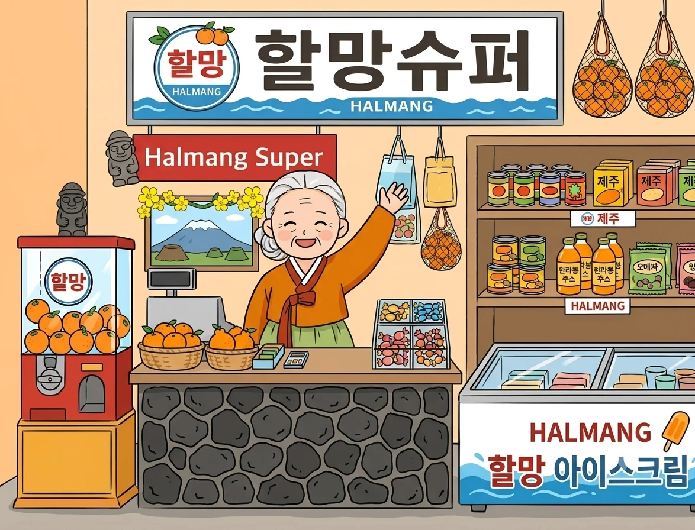

# 🍊 설문대할망이 담아주는 제주나들이

**내·외국인 관광객이 장 보듯 제주 나들이 코스를 골라 담는 관광코스 마켓**

[](https://project-jnuedu001-1062.vercel.app)


**[👉 사이트 열기](https://project-jnuedu001-1062.vercel.app)** · **[GitHub](https://github.com/So-yoonKim/project)**

</div>

---

## 📖 목차

[소개](#-소개) · [기획 의도](#-기획-의도) · [화면](#-화면) · [주요 기능](#-주요-기능) · [공공데이터 API](#-사용한-공공데이터-api) · [AI 에이전트](#-ai-에이전트) · [구조](#-구조) · [실행](#-실행) · [보완하고 싶은 점](#-보완하고-싶은-점) · [출처](#-이미지출처)

## 🗿 소개

제주의 거인 여신 **설문대할망**이 레트로 슈퍼마켓 주인으로 서 있는 가게에서, 마을·바다·오름·실내·커피·식사 **6개 진열대**를 둘러보고 마음에 드는 나들이를 장바구니에 담습니다. **장바구니가 곧 나만의 관광코스**입니다. 한국어·English·中文·日本語·Русский 5개 언어로 볼 수 있습니다.

- **제주 IP**: 설문대할망 신화와 오름 (제주 창세 신화의 거인 여신이 치마폭의 흙으로 한라산과 오름을 만들었다는 이야기)
- **배포 주소**: https://project-jnuedu001-1062.vercel.app

## 🎯 기획 의도

| | |
|---|---|
| 누구를 위해 | 제주를 처음 오는 내국인·외국인 관광객 |
| 어떤 문제 | 검색 결과는 많은데 하루 코스로 묶기 어렵고, 외국인은 한국어 정보를 읽기 어렵다 |
| 어떻게 | 슈퍼마켓에서 장 보듯 카테고리별로 장소를 골라 장바구니(=코스)에 담고, 닉네임과 비밀번호로 저장해 다른 기기에서도 이어 본다 |
| 제주 IP | 설문대할망 캐릭터가 안내하고, 소개 포스트잇으로 신화를 들려준다 |
| 누구에게 어떤 가치 | **관광객**에게는 장 보듯 쉬운 코스 짜기와 5개 언어, **도민과 제주**에게는 한곳에 몰리지 않는 다양한 장소 소개와 자연을 아끼는 당부. 도민과 관광객 모두에게 좋은 **지속가능한 관광**을 지향했다 |

## 🖼 화면

<table>
<tr>
<td width="50%">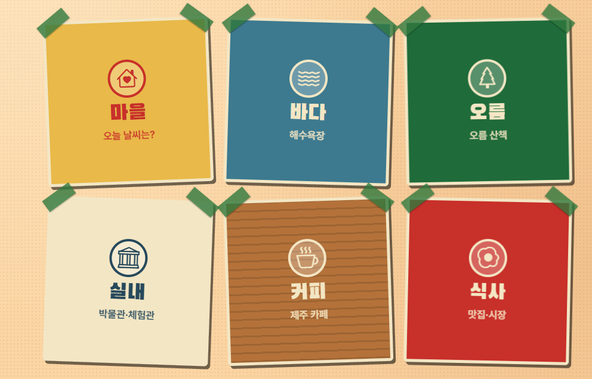<br><sub><b>6개 진열대</b> — 카드를 누르면 목록이 펼쳐져요</sub></td>
<td width="50%">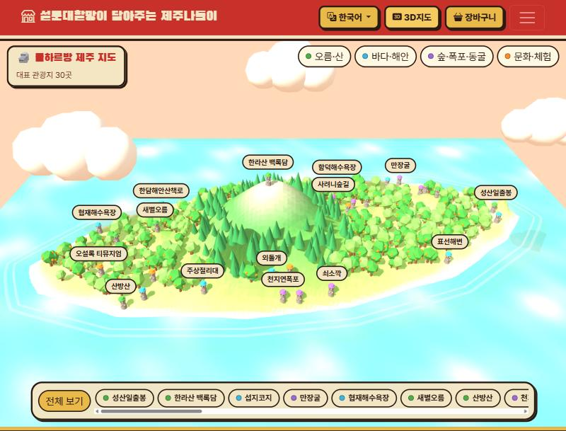<br><sub><b>3D 제주 지도</b> — 돌하르방 핀 30곳</sub></td>
</tr>
<tr>
<td width="50%">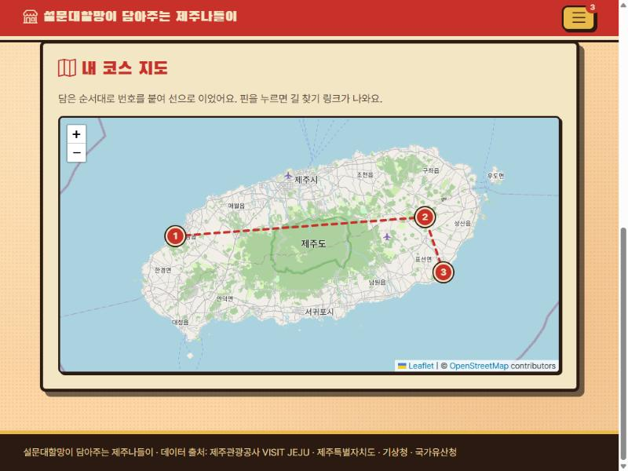<br><sub><b>내 코스 지도</b> — 담은 순서대로 번호 핀과 점선으로 경로를 보여줘요 (예시 코스)</sub></td>
<td width="50%">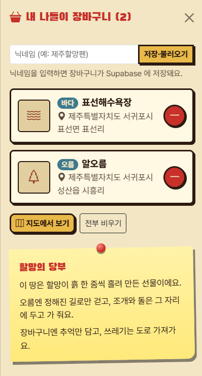<br><sub><b>장바구니와 할망의 당부</b> — 코스를 담으면 노란 포스트잇이 나타나요</sub></td>
</tr>
</table>

**5개 언어로 본 장바구니** — 장소 이름·주소가 고른 언어로 번역되고, 한국어 원문이 이름 아래에 작게 함께 보여요. 화면 문구와 `할망의 당부`도 같은 언어로 바뀝니다.

<table>
<tr>
<td align="center">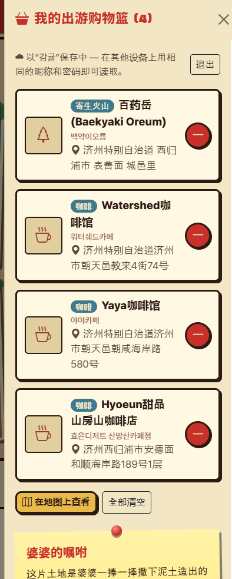<br><sub>中文</sub></td>
<td align="center">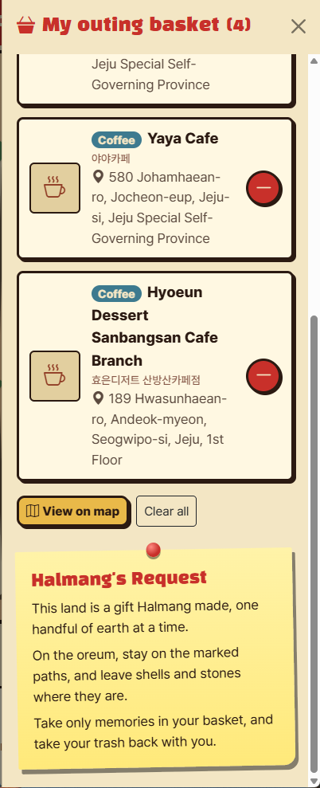<br><sub>English</sub></td>
<td align="center">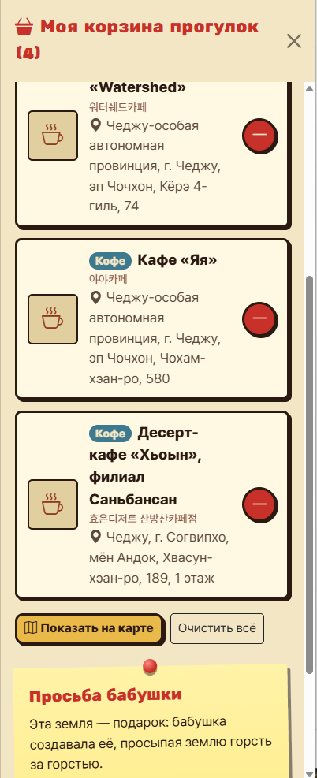<br><sub>Русский</sub></td>
</tr>
</table>

**사용 흐름**: 간판 버튼 `제주나들이 골라봅서!` → 카드 6장 → 목록에서 `+` 로 담기 → 장바구니 → 코스 지도

## ✨ 주요 기능

| | 기능 | 설명 |
|---|---|---|
| 🛒 | **6개 진열대** | 마을(날씨)·바다·오름·실내·커피·식사. 카드를 누르면 목록이 펼쳐지고, 한 번 더 누르면 접혀요 |
| 🧺 | **장바구니(내 나들이)** | 각 항목의 `+` 로 담고 `-` 로 빼요. 주소와 좌표가 함께 저장돼요 |
| 💾 | **Supabase 저장** | **닉네임 + 숫자 비밀번호(4~6자리)** 로 들어오면 `trips` 테이블에 저장돼서, 새로고침하거나 다른 기기에서도 이어 볼 수 있어요. 닉네임은 하나뿐(대소문자 구분 없이 중복 불가)이고, 비밀번호를 아는 사람만 그 장바구니를 보고 고칠 수 있어요 |
| 🤖 | **AI 가이드** | "할망에게 물어봅서" — 공공데이터 API를 도구로 직접 골라 호출하고, 부른 도구를 화면에 보여줘요 |
| 🌏 | **5개 언어** | 화면 문구·날씨·영업시간을 번역하고, 장소 이름과 주소는 AI 가 번역해요 (한국어 원문도 함께 표시) |
| 🗺 | **내 코스 지도** | 담은 장소를 번호 핀으로 꽂고 순서대로 이어요. 핀을 누르면 구글맵 길 찾기 링크가 나와요. 선은 담은 순서를 이은 것이고 이동 거리·시간은 아직 계산하지 않아요 (OpenStreetMap + Leaflet) |
| 🧊 | **3D 제주 지도** | three.js 로 만든 돌하르방 핀 30곳. 핀을 누르면 카메라가 날아가고 설명 카드가 열리며, 카드에서 바로 장바구니에 담아요 |
| 📝 | **설문대할망 포스트잇** | 첫 화면에서 신화를 소개해요 |
| 🌿 | **할망의 당부** | 장바구니에 한 곳 이상 담으면 서랍 아래에 노란 포스트잇이 나타나, 오름에서는 정해진 길로 걷고 조개와 돌은 두고 쓰레기는 가져가 달라고 부탁해요 (선택한 언어 한 가지로 표시) |

### 3D 지도 사용법

- 처음에는 지도가 천천히 돌다가, 손대면 멈춰요
- 모자 색으로 종류를 구분해요: 🟢 오름·산 · 🔵 바다·해안 · 🟣 숲·폭포·동굴 · 🟠 문화·체험
- 핀이나 아래 목록을 누르면 선택, **한 번 더 누르면 선택 해제**
- 오른쪽 위 칩으로 종류별로 켜고 끌 수 있고, `전체 보기` 로 처음 시점으로 돌아와요
- **날씨 연동**: 기상청 예보(제주시)를 가져와 비·눈이면 빗방울·눈송이와 물결, 흐리면 안개와 어두운 구름이 나와요. 오른쪽 아래 `날씨 미리보기` 로 맑음·구름·흐림·비·눈을 직접 골라 볼 수 있고, `실제` 를 누르면 지금 날씨로 돌아와요
- 핀의 좌표는 대략값이에요
- three.js 는 이 화면에 들어갈 때만 불러와요 (지연 로딩)

#### 날씨에 따라 바뀌는 모습

<table>
<tr>
<td width="50%">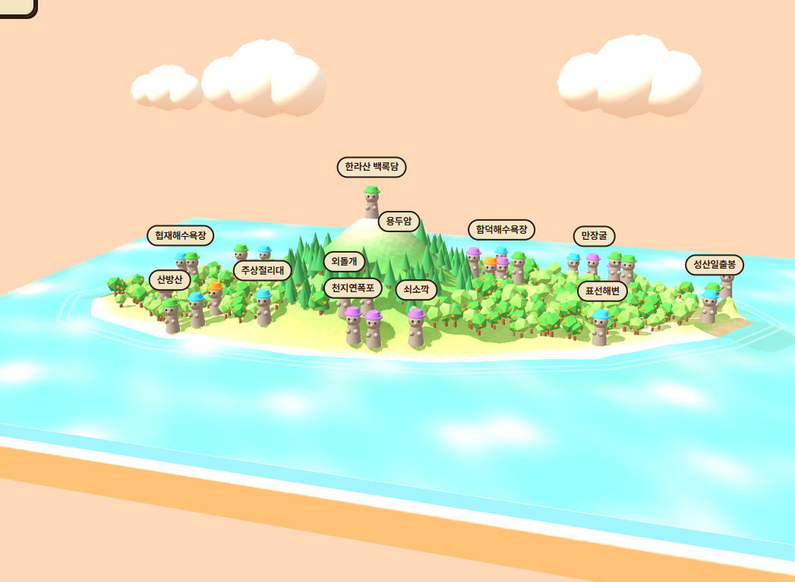<br><sub><b>맑음</b> — 평소 모습</sub></td>
<td width="50%">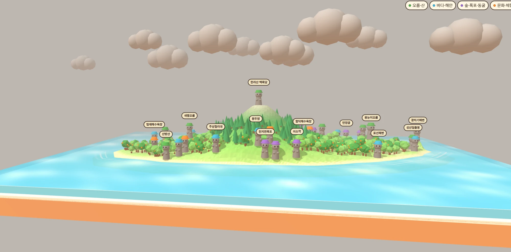<br><sub><b>흐림</b> — 안개와 어두운 구름</sub></td>
</tr>
<tr>
<td width="50%">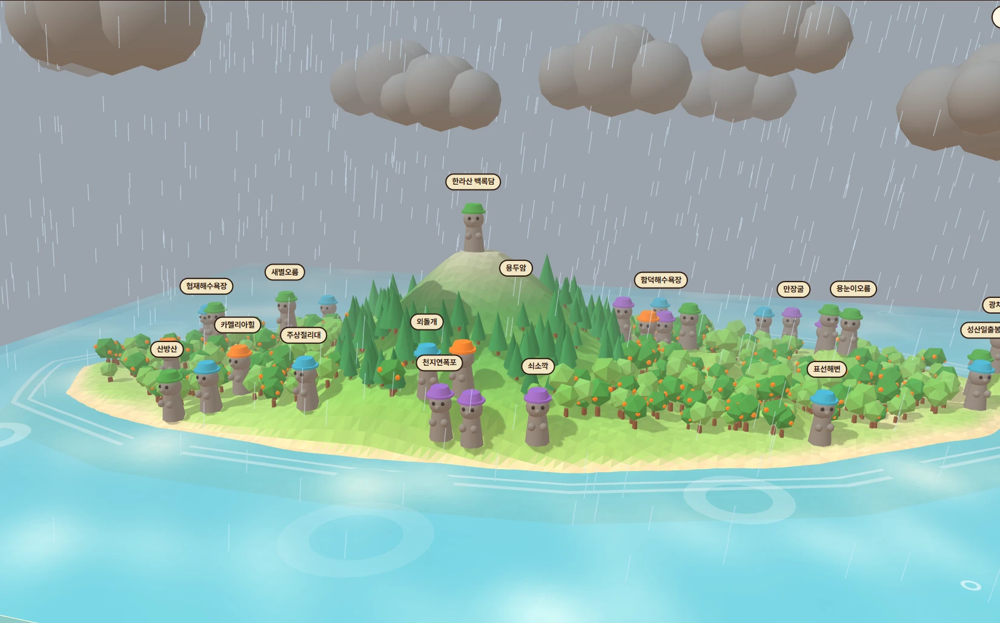<br><sub><b>비</b> — 빗방울과 바다에 퍼지는 물결</sub></td>
<td width="50%">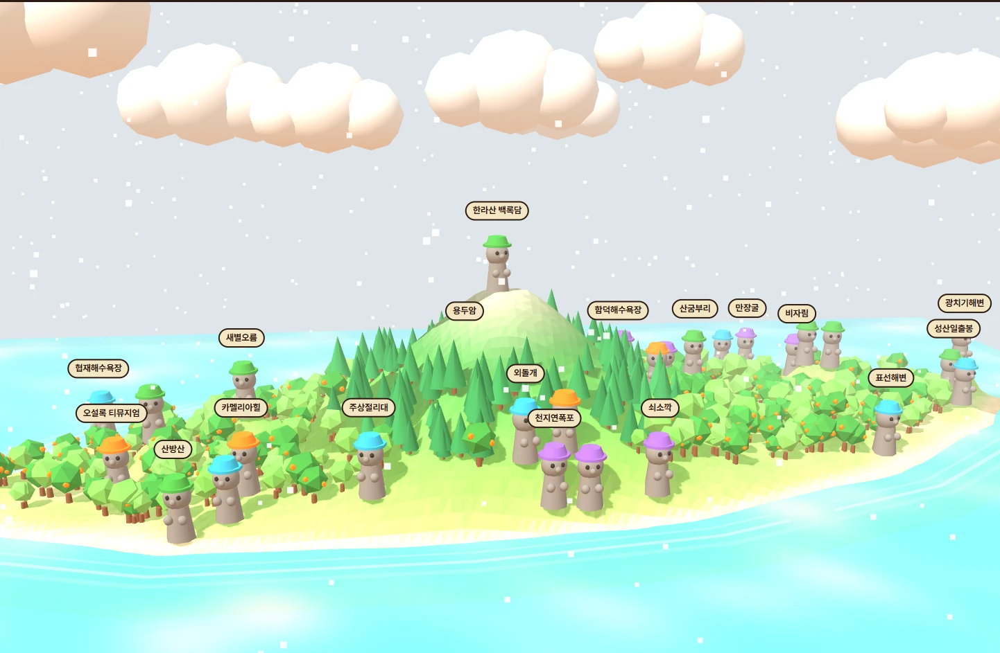<br><sub><b>눈</b> — 눈송이</sub></td>
</tr>
</table>

## 📡 사용한 공공데이터 API

| # | API | 제공 | 용도 |
|---|---|---|---|
| 1 | 제주오름요약설명 | 제주특별자치도 (공공데이터포털) | 오름 이름·위치·표고·설명·좌표 |
| 2 | VISIT JEJU 콘텐츠 | 제주관광공사 (공공데이터포털) | 해수욕장·박물관·카페·맛집·시장의 이름·주소·좌표 |
| 3 | VISIT JEJU 음식점콘텐츠 | 제주관광공사 (공공데이터포털) | 카페·식당 영업시간·예약 가능 여부 (콘텐츠명으로 연결) |
| 4 | 기상청 단기예보 조회서비스 | 기상청 (공공데이터포털) | 제주시·서귀포시 6개 시간대 기온·하늘·강수 |
| 5 | 국가유산청 국가유산 검색 | 국가유산청 (키 불필요) | AI 에이전트의 도구 |

> 1~4번은 화면에 실제 데이터가 표시됩니다. 5번은 에이전트 도구로 연결되어 있습니다.
> 공공데이터에 사진이 없어 카테고리 아이콘으로 대신 표시하고, 카페·해수욕장은 별도 분류가 없어 제목 키워드로 찾기 때문에 이름이 비슷한 다른 장소가 섞일 수 있습니다.

## 🤖 AI 에이전트

`api/agent.js` — AI가 질문을 보고 필요한 도구를 스스로 골라 호출하는 반복 루프(최대 5회)입니다. Claude(`claude-sonnet-5-5`)가 도구를 고르고 답합니다.

| 도구 | 하는 일 | 연결된 API |
|---|---|---|
| `search_jeju_places` | 바다·오름·실내·커피·식사 장소 검색 | 1, 2, 3 |
| `get_weather` | 제주시/서귀포시 예보 | 4 |
| `search_heritage` | 제주 국가유산 검색 | 5 |

- **시스템 지시**: 설문대할망 말투, 도구 결과에 없는 장소는 지어내지 않기, 비 오면 실내 대안 제안, 5문장 이내, 마크다운 기호 쓰지 않기
- 화면에서 고른 언어로 답하고, 대화 기록은 최근 10개만 보냅니다
- 호출한 도구와 건수가 답변 위에 표시됩니다
- **연습 모드**: AI 키가 없으면 오류 대신 미리 준비한 할망 말투 답변을 보여주고, 화면에 "연습 모드"라고 표시합니다 (도구 호출 없음)
- 장소 이름·주소 번역(`/api/translate`)도 같은 Claude 키를 씁니다. 키가 없거나 거절되면 번역을 못 하고 한국어 원문이 그대로 보입니다

### ✅ 테스트 기록 (배포 사이트에서 직접 실행)

| # | 질문 | 기대 동작 | 결과 |
|---|---|---|---|
| 1 | 제주 실내 관광지 추천 | `search_jeju_places` (실내) | 실내 카테고리로 8건을 찾아 박물관 4곳을 주소와 함께 추천 |
| 2 | 서귀포 비오는 날 해녀 문화 체험 코스 추천 | 도구 2개 이상 연속 호출 | `get_weather` → `search_jeju_places`(실내) → `search_heritage` → `search_jeju_places`(식사) 4번 호출. 날씨를 확인하고 해녀 체험 장소 3곳과 비 올 때의 대안을 제안 |
| 3 | 제주에 있는 피사의사탑 추천 | 지어내지 않고 "결과 없음" | 4번 검색해 결과가 없자 "못 찾았다"고 답하고, 이름이 비슷한 방사탑 2곳을 대안으로 제시 |
| 4 | 만장굴이 어떤 유산이야? | `search_heritage` | 국가유산 검색 1건으로 "제주 김녕굴과 만장굴(천연기념물)"을 찾고, 도구에 없는 세부 설명은 모른다고 답함 |

에이전트가 필요한 도구를 스스로 고르고(1·4번은 1종, 2번은 3종), 결과에 없는 내용은 지어내지 않는 것을 확인했습니다.

<details>
<summary>📸 캡처 보기</summary>

<table>
<tr>
<td>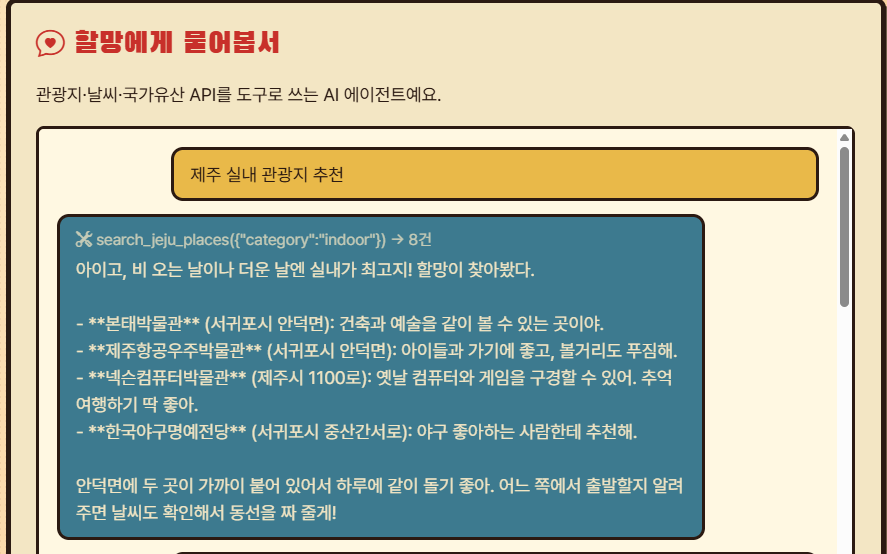<br><sub>1. 제주 실내 관광지 추천</sub></td>
<td>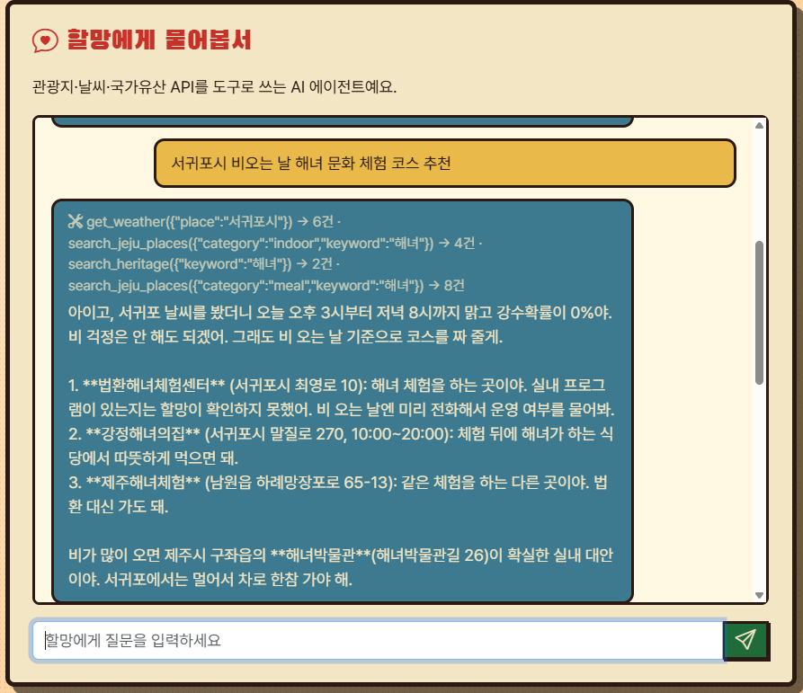<br><sub>2. 서귀포 비오는 날 해녀 체험 코스</sub></td>
</tr>
<tr>
<td>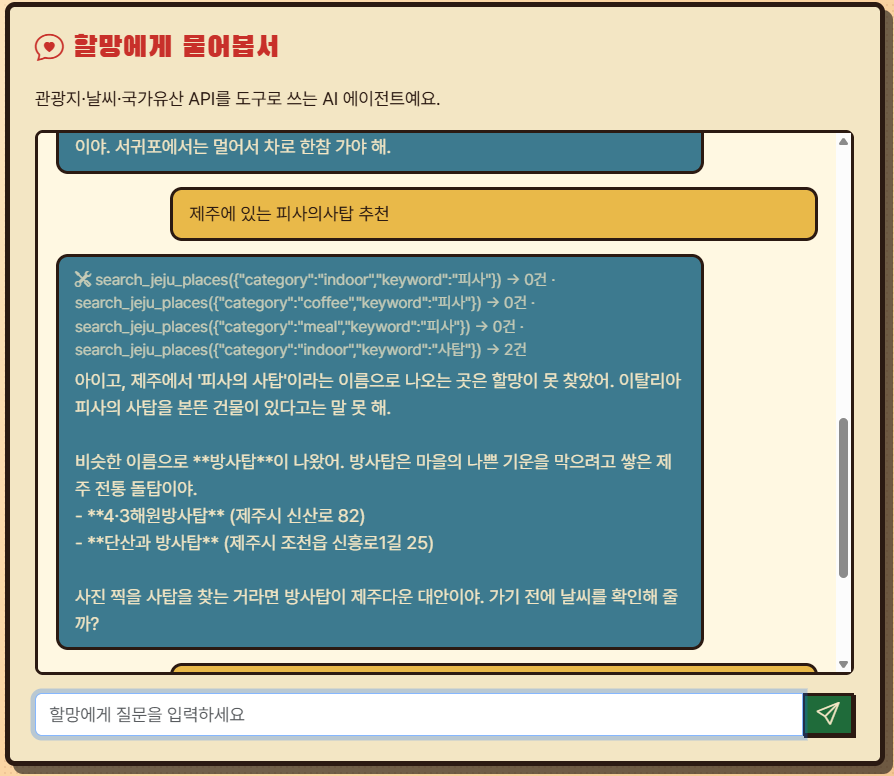<br><sub>3. 피사의사탑 (결과 없음)</sub></td>
<td>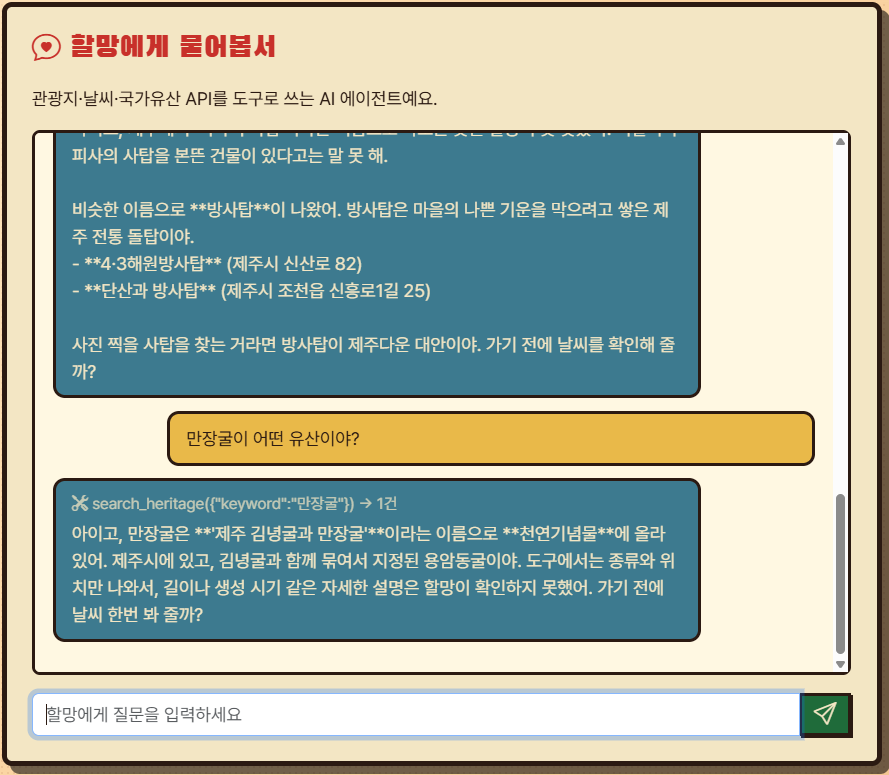<br><sub>4. 만장굴 국가유산</sub></td>
</tr>
</table>

</details>

## 🏗 구조

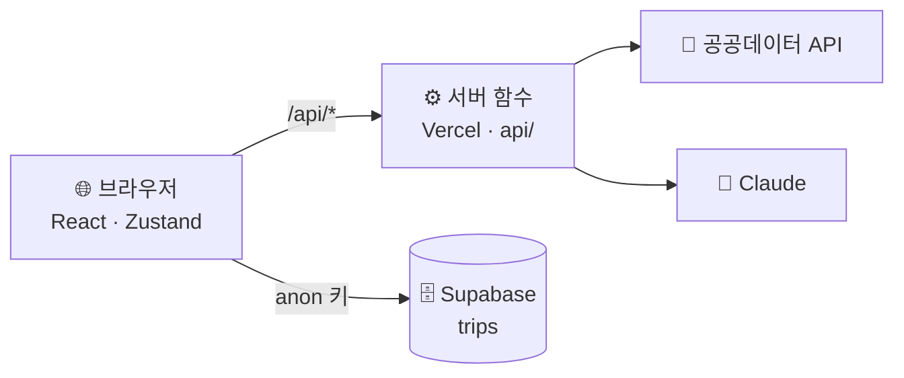

공공데이터 키와 AI 키는 서버(`api/`)에서만 쓰고, 브라우저에는 들어가지 않습니다. 브라우저에 들어가는 값은 `VITE_` 로 시작하는 Supabase 공개 키뿐입니다.

```
api/                 Vercel 서버 함수 (/api/파일이름) — 비밀 키는 여기서만
  agent.js             AI 에이전트
  places.js            카테고리별 장소 (화면용)
  weather.js · heritage.js · hello.js · translate.js
server/              공공데이터·AI 호출 함수 (api/ 와 에이전트가 함께 사용)
  odcloud.js           공공데이터포털 odcloud 방식 공통 호출
  translate.js         장소 이름·주소 AI 번역 (한 번 번역한 건 저장)
  visitjeju.js         VISIT JEJU 콘텐츠 + 음식점콘텐츠
  oreum.js · weather.js · heritage.js · places.js
  practice.js          AI 키가 없을 때의 연습 모드 답변
src/
  main.jsx · router.jsx
  layouts/             공통 틀 (메뉴·푸터·알림)
  pages/               Home · Agent · Map3D · Check · NotFound
  components/          Halmang · HalmangNote · CategoryCard · PlaceList · WeatherList · CartDrawer · CourseMap · LangSwitcher
  three/jejuScene.js   3D 제주 지도 장면 (three.js)
  data/                categories.js (6개 카테고리) · places3d.js (3D 지도 30곳과 번역)
  store/useAppStore.js Zustand 전역 상태 (장바구니·닉네임·언어·알림·에이전트 대화)
  i18n/                번역 사전(messages.js)과 useT 훅
  lib/supabase.js · lib/geo.js · api/client.js · assets/
supabase/schema.sql  trips 테이블 만들기
supabase/nickname-pin.sql  닉네임 + 비밀번호 보호 (표·함수·권한)
docs/                README 이미지
```

## 🚀 실행

```bash
npm install
cp .env.example .env.local      # 값 채우기 (Windows: copy .env.example .env.local)
npm run dev                     # http://localhost:5173  (화면 + /api 함께 실행)
```

`npm run dev` 에서도 `/api` 가 동작하도록 `vite.config.js` 에 개발용 플러그인을 넣었습니다. 배포 환경에서는 Vercel 이 `api/` 를 실행합니다.

### 환경변수 (`.env.local`, 배포 시 Vercel Environment Variables)

| 이름 | 설명 |
|---|---|
| `DATA_GO_KR_KEY` | 공공데이터포털 **Decoding** 키 (서버 전용) |
| `ANTHROPIC_API_KEY` | Claude API 키 (서버 전용). AI 가이드와 이름·주소 번역에 쓰입니다 |
| `VITE_SUPABASE_URL` | Supabase Project URL (`https://xxxx.supabase.co`) |
| `VITE_SUPABASE_ANON_KEY` | Supabase anon(publishable) 키 |

`VITE_` 로 시작하는 값만 브라우저에 들어갑니다. `.env.local` 은 `.gitignore` 에 들어 있어 GitHub 에 올라가지 않습니다. AI 키가 없어도 사이트는 동작하고, 에이전트는 연습 모드로 답하며 장소 이름·주소는 한국어로 보입니다. 환경변수를 바꾼 뒤에는 Vercel 에서 Redeploy, 내 컴퓨터에서는 `npm run dev` 를 다시 켜야 적용됩니다.

### Supabase 준비

Supabase 대시보드 → SQL Editor 에서 아래 두 파일을 **순서대로** 실행합니다.

1. `supabase/schema.sql` — `trips` 테이블을 만듭니다
2. `supabase/nickname-pin.sql` — 닉네임 + 숫자 비밀번호 보호를 켭니다

두 번째 파일이 하는 일:
- 닉네임을 하나뿐으로 만들고(대소문자 구분 없이 중복 불가), 비밀번호는 암호화(bcrypt)해서 저장합니다. 5번 틀리면 15분 동안 잠깁니다
- 로그인에 성공하면 임시 열쇠(30일)를 줍니다. 브라우저에는 비밀번호가 아니라 이 열쇠만 남습니다
- `trips` 를 브라우저가 직접 읽고 쓰던 실습용 정책(누구나 읽기·쓰기·삭제)을 지우고, 장바구니는 닉네임을 확인하는 DB 함수로만 다룹니다

Supabase Auth 이메일 로그인만큼 강한 방식은 아닙니다. 숫자 4~6자리 비밀번호를 쓰므로 중요한 정보를 담는 서비스에는 이메일 로그인으로 바꿔야 합니다. 동작 체크 화면(`/check`)에서 이 파일을 실행했는지 확인할 수 있습니다.

### 배포 (Vercel)

1. GitHub 저장소를 Vercel 에서 Import
2. Settings → Environment Variables 에 위 변수를 입력
3. Redeploy (환경변수는 다시 배포해야 적용돼요)
4. 고정 주소(`프로젝트명.vercel.app`)를 시크릿 창에서 열어 확인

## 🔧 보완하고 싶은 점

- **외국어 검수**: 화면 문구와 AI 번역(장소 이름·주소)을 원어민이 검수해요
- **3D 지도와 실제 사용자의 여행경로 연동**: 사용자가 장바구니에 담은 코스를 3D 지도 위에 이어서 보여줘요
- 그 밖에: 장바구니 순서 바꾸기(드래그)와 이동 거리·시간으로 경로를 한눈에, 공공데이터 다국어 소개 글(영·중·일)로 설명 보강, 코스 공유 링크, 이메일 로그인(Supabase Auth)으로 비밀번호 보호 강화

## 🙏 이미지·출처

- 메인 일러스트(할망슈퍼): 제작자가 AI 이미지 생성 도구로 직접 만든 이미지
- 지도: © [OpenStreetMap](https://www.openstreetmap.org/copyright) contributors (Leaflet 으로 표시, 키·결제 불필요)
- 데이터: 제주특별자치도, 제주관광공사 VISIT JEJU, 기상청, 국가유산청 (공공데이터포털)
